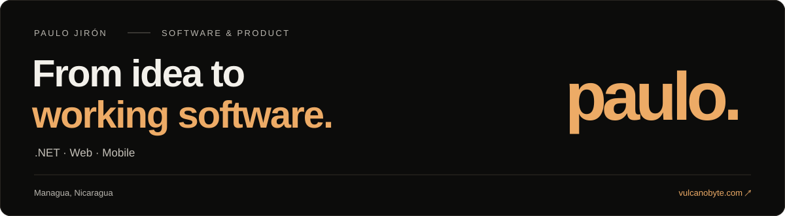

  <a href="https://vulcanobyte.com"><strong>Portafolio</strong></a> ·
  <a href="https://www.linkedin.com/in/paulo-jir%C3%B3n-2ab376231/">LinkedIn</a> ·
  <a href="https://vulcanobyte.com/#contacto">Hablemos</a> ·
  <a href="README.md">English</a>

Soy **Paulo**, **Senior .NET & Full-Stack Engineer** de **Managua, Nicaragua**.
Construyo servicios backend, interfaces web y aplicaciones móviles, conectando las reglas de negocio con las personas que usan el software.

Trabajo con diseño de APIs, identidad, mensajería asíncrona y despliegue. Aquí comparto herramientas personales, prototipos y proyectos de aprendizaje; mi [portafolio](https://vulcanobyte.com/#trayectoria) presenta mi experiencia profesional.

### Proyectos seleccionados

| Proyecto | Qué vas a encontrar | Estado |
| :--- | :--- | :--- |
| **[NicaStack CLI](https://github.com/mayorgacdev/nicastack-cli)** | Una herramienta .NET con asistente interactivo, selección de plantillas de arquitectura y diagnóstico del entorno. | Experimental |
| **[Web Indexer](https://github.com/mayorgacdev/web-indexer)** | Un prototipo de catálogo y búsqueda de sitios web con .NET, Next.js, Typesense y mensajería asíncrona. | Prototipo |
| **[StockMaster API](https://github.com/mayorgacdev/stock-master-api)** | Un proyecto de aprendizaje de API de inventario con productos, proveedores, almacenes y clientes. | Aprendizaje |

### Herramientas con las que trabajo

**Backend** · C# / .NET · ASP.NET Core · Entity Framework Core · PostgreSQL · SQL Server  
**Web y móvil** · TypeScript · React / Next.js · Flutter  
**Integración y entrega** · MassTransit · SignalR · .NET Aspire · Docker · OpenTelemetry

### Notas de ingeniería

- [Un clic. Una operación.](https://vulcanobyte.com/articulos/idempotencia) — Idempotencia.
- [Reintentar también puede romper tu sistema.](https://vulcanobyte.com/articulos/reintentos-y-resiliencia) — Reintentos y resiliencia.
- [Antes de añadir un índice, mira el plan.](https://vulcanobyte.com/articulos/sql-leer-el-plan) — Rendimiento de consultas.

---

**De Managua, para cualquier lugar.** [vulcanobyte.com](https://vulcanobyte.com)
