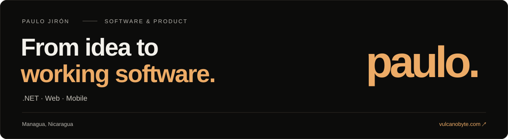

  <a href="https://vulcanobyte.com"><strong>Portfolio</strong></a> ·
  <a href="https://www.linkedin.com/in/paulo-jir%C3%B3n-2ab376231/">LinkedIn</a> ·
  <a href="https://vulcanobyte.com/#contacto">Get in touch</a> ·
  <a href="README.es.md">Español</a>

I'm **Paulo**, a **Senior .NET & Full-Stack Engineer** from **Managua, Nicaragua**.
I build backends, web interfaces and mobile apps, connecting business rules with the people who use the software.

My work spans API design, identity, asynchronous messaging and deployment. Here I share personal tools, prototypes and learning projects; my [portfolio](https://vulcanobyte.com/#trayectoria) covers my professional experience.

### Selected projects

| Project | What you'll find | Stage |
| :--- | :--- | :--- |
| **[NicaStack CLI](https://github.com/mayorgacdev/nicastack-cli)** | A .NET tool with an interactive wizard, architecture template selection and environment checks. | Experimental |
| **[Web Indexer](https://github.com/mayorgacdev/web-indexer)** | A website catalog and search prototype using .NET, Next.js, Typesense and asynchronous messaging. | Prototype |
| **[StockMaster API](https://github.com/mayorgacdev/stock-master-api)** | An inventory API learning project with products, suppliers, warehouses and customers. | Learning project |

### Tools I work with

**Backend** · C# / .NET · ASP.NET Core · Entity Framework Core · PostgreSQL · SQL Server  
**Web & mobile** · TypeScript · React / Next.js · Flutter  
**Integration & delivery** · MassTransit · SignalR · .NET Aspire · Docker · OpenTelemetry

### Engineering notes · en español

- [Un clic. Una operación.](https://vulcanobyte.com/articulos/idempotencia) — Idempotency.
- [Reintentar también puede romper tu sistema.](https://vulcanobyte.com/articulos/reintentos-y-resiliencia) — Retries and resilience.
- [Antes de añadir un índice, mira el plan.](https://vulcanobyte.com/articulos/sql-leer-el-plan) — Query performance.

---

**De Managua, para cualquier lugar.** [vulcanobyte.com](https://vulcanobyte.com)
